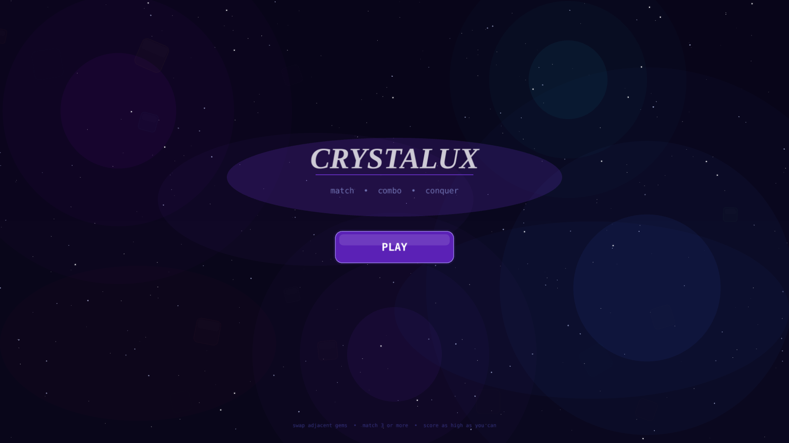
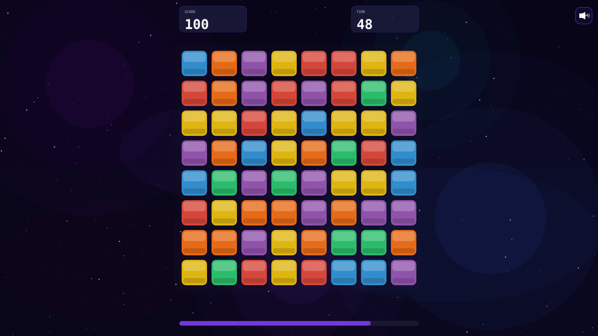
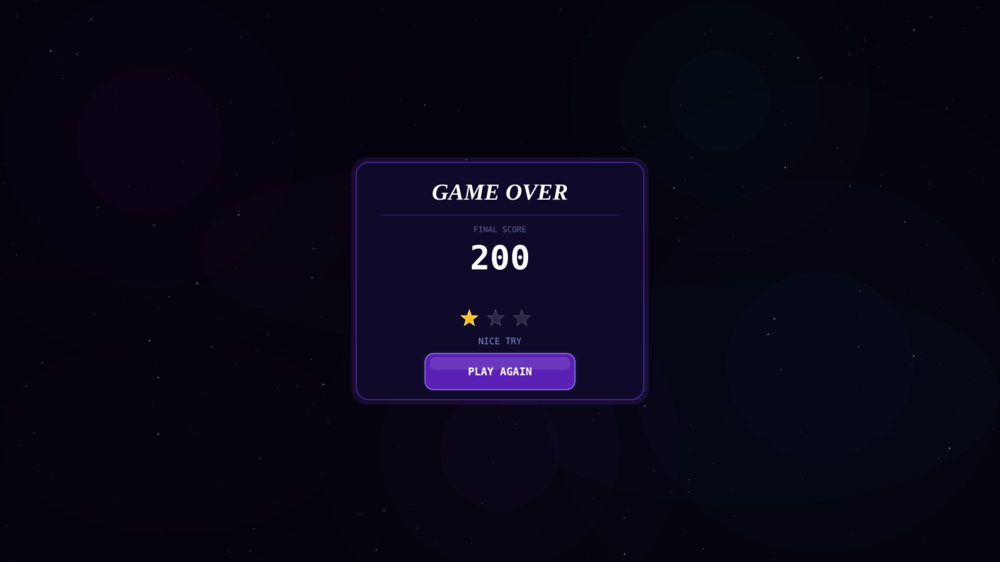

# Crystalux

A fast-paced match-3 gem puzzler built with [PixiJS v8](https://pixijs.com/). Swap adjacent gems, chain combos, and set off bombs to score as high as you can before the 60-second timer runs out.

**Play it live:** [crystalux.netlify.app](https://crystalux.netlify.app/)





## Gameplay

- **8×8 board, 6 gem colours.** Swap two adjacent gems to line up 3 or more.
- **Bigger matches score more:** 100 for a match-3, 250 for a match-4, 500 for a match-5.
- **Bomb gems** spawn occasionally and blow up the gems around them for bonus points.
- **Cascades and combos.** Gems fall to fill gaps, and chain reactions trigger callouts like *COMBO x2*, *ON FIRE!* and *MEGA MATCH!*.
- **Hints.** Stay idle for 5 seconds and a valid move pulses on the board.
- **60-second rounds** with an animated final score and a star rating at the end.

## Features

- Scene system (title → game → end) with fade transitions
- Tween system for swap and fall animations
- Pooled particles for match bursts
- Bitmap-font HUD with score, timer bar and mute toggle
- Background music and sound effects
- Responsive layout. The grid scales to fit any screen, with touch support for mobile.

## Running locally

```bash
npm install
npm run dev
```

### Build for production

```bash
npm run build
npm run preview
```

## Project structure

```
Crystalux/
├── src/
│   ├── main.js              # app init, audio loading, scene manager
│   ├── constants.js         # grid size, gem types, scoring, timings
│   ├── game/                # Gem, Grid, MatchSolver, GemFaller
│   ├── scenes/              # TitleScene, GameScene, EndScene
│   ├── systems/             # Audio, Tween, Particles, Hints, Background, SceneManager
│   └── ui/                  # HUD, ScorePopup, CommentaryLabel
└── public/assets/audio/     # music and sound effects
```
