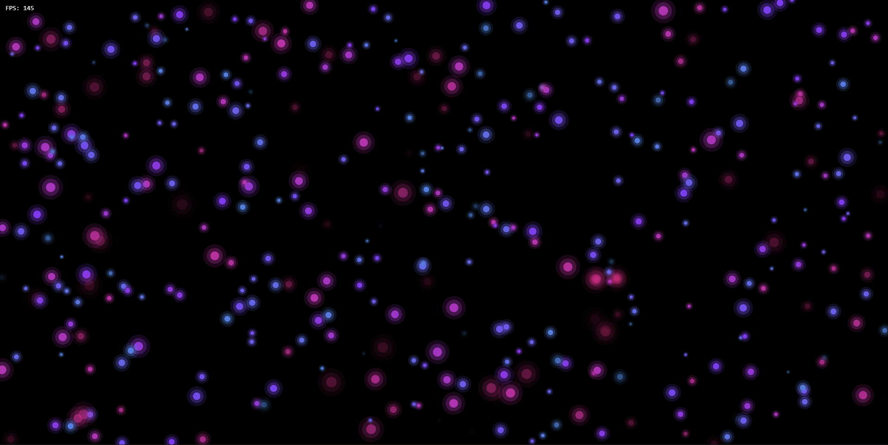

# Nebula

An interactive cosmic particle experience built with [PixiJS v8](https://pixijs.com/). Hundreds of glowing particles drift through space. Move your cursor to pull them toward you, and click to set off a burst.

**Try it live:** [nebula-pixijs.netlify.app](https://nebula-pixijs.netlify.app/)




## Interaction

- **Move** the cursor (or drag on touch screens) to attract nearby particles.
- **Click / tap** to burst 20 new particles out from that point.

## Features

- **Object pooling.** 2,000 particles are created up front and recycled, so nothing is allocated mid-frame. About 600 stay active at a time.
- **Custom GLSL filter** (`nebula.frag.glsl`) adds a time-based chromatic aberration fringe and a subtle brightness "breathing" pulse.
- **Colour gradient.** Particles blend from blue through violet to magenta, and bursts use their own soft purple palette.
- **Noise-based drift.** Particles get a gentle wandering motion, and cursor velocity affects how they're pulled.
- **Live HUD** showing FPS and active particle count.
- **Installable PWA** with a web manifest, app icons and a service worker for offline caching.

## Running locally

```bash
npm install
npm run dev
```

### Build for production

```bash
npm run build
npm run preview
```

## Project structure

```
Nebula/
├── src/
│   ├── main.js                   # app init, particle loop, input → bursts
│   ├── entities/NebulaParticle.js
│   ├── shaders/nebula.frag.glsl  # chromatic aberration + pulse filter
│   ├── systems/                  # ParticlePool, RenderSystem, InputSystem
│   └── ui/HUD.js                 # FPS + particle counter
├── public/                       # PWA manifest, icons, service worker
└── scripts/gen-icons.mjs         # generates the app icon SVGs
```
