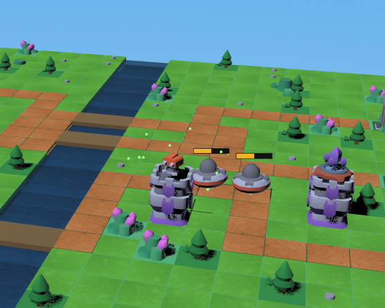
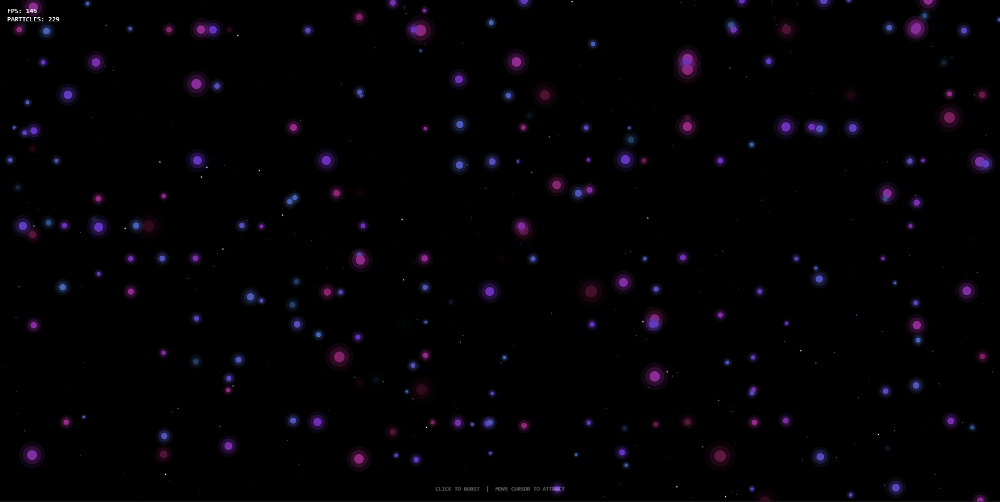

# PixiJS Games

A collection of browser games and interactive experiences I've built with [PixiJS](https://pixijs.com/). Each folder is a self-contained [Vite](https://vite.dev/) project with its own README.

| Game | What it is | Tech | Play |
| --- | --- | --- | --- |
| 🏰 [**Void Rush**](Void-Rush/) | 3D tower defense with branching upgrades and boss waves | PixiJS v7 + pixi3d, Babylon.js | [▶️ Live](https://voidrushpixi.netlify.app/) |
| 💎 [**Crystalux**](Crystalux/) | 60-second match-3 gem puzzler with combos and bombs | PixiJS v8 | [▶️ Live](https://crystalux.netlify.app/) |
| 🌌 [**Nebula**](Nebula/) | Interactive cosmic particle experience with a custom GLSL shader | PixiJS v8 | [▶️ Live](https://nebula-pixijs.netlify.app/) |

---

## 🏰 Void Rush

A 3D tower defense game built twice on the same game data, once with **PixiJS + pixi3d** (with a custom GLB loader) and once with **Babylon.js**. Place Frost, Laser, Cannon, Tesla and Spike Trap towers, unlock branching upgrades, and survive escalating waves with boss encounters.

[](https://voidrushpixi.netlify.app/)

**[Play it live](https://voidrushpixi.netlify.app/)** · [Source & details](Void-Rush/)

---

## 💎 Crystalux

A fast match-3 puzzler. Swap gems on an 8×8 board, chain cascades into combos, trigger bomb gems, and race a 60-second clock. It also has hints, particle bursts, music and sound effects, and a responsive layout that works on mobile.

[](https://crystalux.netlify.app/)

**[Play it live](https://crystalux.netlify.app/)** · [Source & details](Crystalux/)

---

## 🌌 Nebula

A pool of 2,000 glowing particles that drift with noise-based motion. Move your cursor to attract them and click to burst new ones. A custom GLSL filter adds a chromatic-aberration shimmer, and the whole thing installs as a PWA.

[](https://nebula-pixijs.netlify.app/)

**[Try it live](https://nebula-pixijs.netlify.app/)** · [Source & details](Nebula/)

---

## Running any project locally

```bash
cd Crystalux      # or Nebula, Void-Rush/pixi3d, Void-Rush/babylon3d
npm install
npm run dev
```
